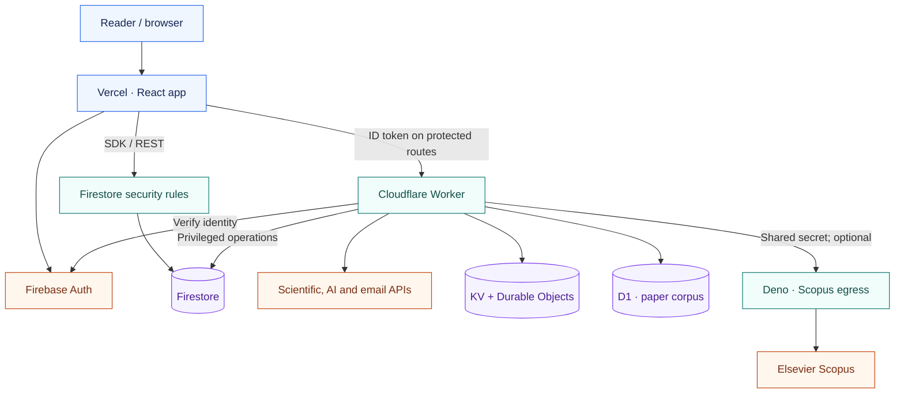
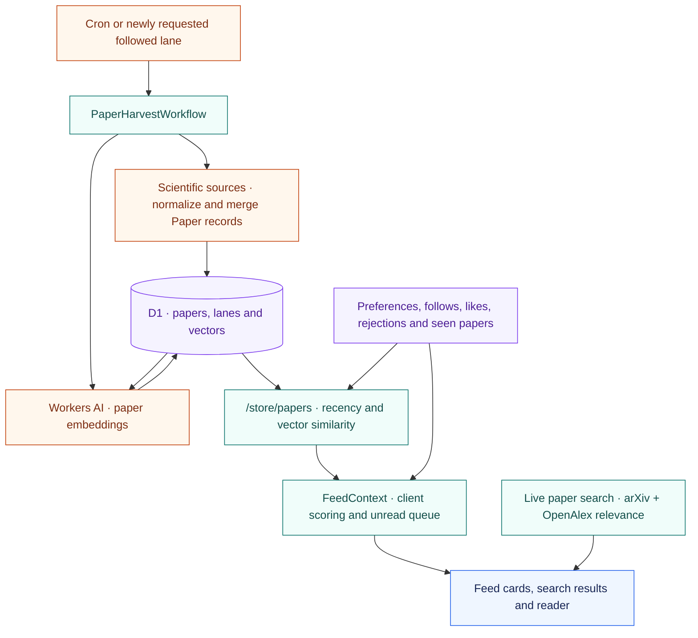

# PaperTok architecture

Start here to find the current implementation and its documentation. This page
describes boundaries and data flow; the linked owners hold contracts, commands
and configuration details.

## Runtime boundaries

- [app.tsx](src/app.tsx) owns routes and provider composition.
  [AuthContext](src/context/auth-context.tsx) owns frontend identity and profile
  lifecycle. User data reaches Firestore through the browser SDK and REST
  services, with authorization enforced by [firestore.rules](firestore.rules).
- [vercel.json](vercel.json) serves SPA routes, proxies Firebase auth and
  analytics paths, and sends supported public-page crawlers to Worker share
  routes. The frontend and Worker deploy separately.
- [worker/instrumentation.ts](worker/instrumentation.ts) reports errors from
  the Worker, bound Durable Objects and harvest Workflow to PostHog.
  [worker/index.ts](worker/index.ts) handles requests and schedules;
  [router.ts](worker/router.ts) dispatches HTTP routes.
  Route and handler checks enforce methods, origins and identity as applicable.
- [provider-runtime.ts](worker/provider-runtime.ts) owns shared provider
  caching, deadlines and quota reservations. Durable Objects own atomic quotas,
  email delivery reservations and rewrite sessions. KV holds notification state,
  institution-service verdicts and rewrite cache records. Exact bindings and
  selected providers live in [wrangler.toml](wrangler.toml).
- [paper-store.ts](worker/paper-store.ts) owns the D1 corpus, paper identity,
  vectors and ranking storage. [paper-feed.ts](worker/paper-feed.ts) serves its
  authenticated read API. [paper-harvest.ts](worker/paper-harvest.ts) runs the
  harvest Workflow started by cron or new followed lanes; scientific retrieval,
  enrichment and Workers AI embeddings populate the corpus. See
  [the paper-store contract](worker/README.md#paper-store) for budgets and retention.
- [proxy/README.md](proxy/README.md) explains the optional Scopus egress and
  its separate credentials. Other external integrations also have direct
  browser callers; this diagram shows the main application boundaries, not
  every outbound request.

## Papers from retrieval to display

The signed-in For You feed reads a shared corpus rather than fetching every
provider for every reader. [paper-sources.ts](worker/paper-sources.ts) and
[paper-enrichment.ts](worker/paper-enrichment.ts) populate it using the shared
[Paper](src/models/paper.ts) contract and
[PaperBuilder](src/services/paper-builder.ts). Harvesting and embedding have
separate bounded steps; the diagram summarizes the resulting data flow.

Area lanes (`area:<area>`) hold OpenAlex journal articles labeled with an area
rather than one of its leaves. [paper-store.ts](worker/paper-store.ts) adds them
to the candidates of a request that asks for the area's leaves and no follows,
without reserving positions in a page. Open and closed access use the same
ranking rules. After embedding,
[leaf-filing.ts](worker/leaf-filing.ts) removes an article from its area lane
once a leaf of the area holds it; in an area with a calibrated rule, it also
files articles under the leaf their vectors match.
[The paper-store contract](worker/README.md#paper-store) gives the areas,
candidate limits and ranking rules.

[paper-store-service.ts](src/services/paper-store-service.ts) requests corpus
pages. Each page says which papers the reader has seen, as a Bloom filter, and
asks the Worker to pass over them: [paper-store.ts](worker/paper-store.ts)
walks the reader's kept ranking past the filter, so a reload is one request
however many pages the reader saw, and each later page goes on from where the
last walk stopped.
[feed-pagination.ts](src/context/feed-pagination.ts) decides when a page the
feed cannot show goes one page on, and shows the page again when the reader
has seen their whole ranking.
[FeedContext](src/context/feed-context.tsx) combines their semantic signal
with the [recommendation engine](src/utils/recommendation-engine.ts), manages
interactions and preserves the unread queue.
[feed-notable-cards.ts](src/context/feed-notable-cards.ts) gives one card in
fifteen to an unseen notable paper the corpus adds after a page; the
[paper-store contract](worker/README.md#paper-store) says how they are chosen
and placed. Other feed modes and guest flows
still have live source callers; this diagram describes the corpus-backed path.
[paper-search-service.ts](src/services/paper-search-service.ts) separately merges
live arXiv and OpenAlex results and applies search relevance.

Missing scientific metadata stays unknown; normalization must preserve its
provenance. See [the paper contract guidance](CONTRIBUTING.md#typescript-and-runtime-checks)
and [frontend decisions](src/AGENTS.md#scientific-data-and-recommendations).

## Documentation owners

The author of a behavior change updates its affected documentation in the same
PR. The code reviewer checks the claims against the implementation. Each topic
has one primary document; other pages should link to it.

| Topic | Primary source |
| --- | --- |
| Product overview and quick start | [README.md](README.md) |
| Runtime boundaries and architecture navigation | This page |
| Setup, TypeScript, checks and documentation workflow | [CONTRIBUTING.md](CONTRIBUTING.md) |
| Worker API, providers, persistence and deployment | [worker/README.md](worker/README.md) |
| Scopus egress | [proxy/README.md](proxy/README.md) |
| UI tokens, components and interaction patterns | [design.md](design.md) |
| Security reporting and credentials | [SECURITY.md](SECURITY.md) |
| Firestore rules testing | [tests/README.md](tests/README.md) |
| Manual diagnostic procedures | [scripts/diagnostics/README.md](scripts/diagnostics/README.md) |
| Constraints for repository changes | [AGENTS.md](AGENTS.md), [frontend decisions](src/AGENTS.md), [Worker decisions](worker/AGENTS.md) |

Historical investigations and superseded implementations can be recovered from
Git history; they do not establish current behavior. Vendored skills under
`.agents/skills/impeccable/` describe their upstream workflows, not PaperTok's
architecture.

When an architecturally significant decision needs its own record, use a short
Markdown document with context, decision, consequences and status. Link it from
the affected primary document. Mark a reversed decision as superseded and link
its replacement; keep the current behavior in the primary document.

## Keeping this map accurate

Update a diagram when a runtime boundary, owner or data flow changes. Link its
source files in the accompanying prose so a reviewer can verify each claim.
Keep provider versions, quotas and command inventories in their existing owners.
See [documentation maintenance](CONTRIBUTING.md#documentation-maintenance) for
the PR evidence and automated checks.
