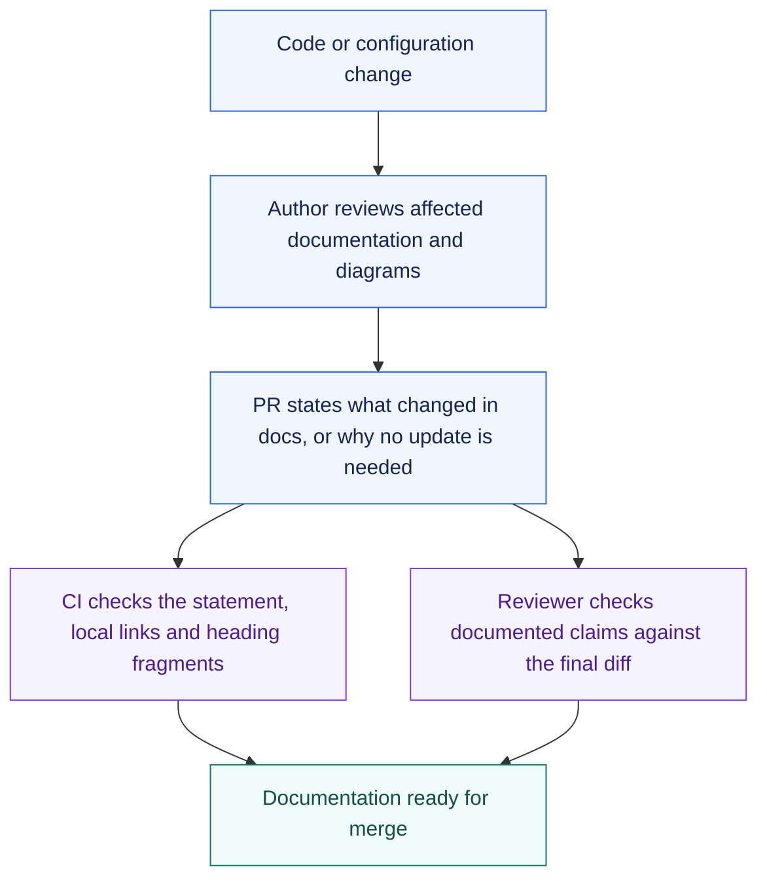

# Contributing to PaperTok

Thanks for helping improve PaperTok. The project is evolving quickly, so focused changes with
clear verification are easiest to review.

## Local Setup

```bash
git clone https://github.com/mugar123/papertok.git
cd papertok
npm ci
cp .env.example .env.local
npm run dev
```

Firebase values are required for authenticated flows. Protected scientific-provider, AI, and
email credentials belong in Cloudflare Worker secrets and must never be added to `.env.local`
as `VITE_*` values.

## Before Opening a Pull Request

```bash
npm run check
```

This runs the secret scan, ESLint (with type-aware rules), knip, TypeScript checks, Node
tests, Vite build and Worker dry-run. Run `npm run test:rules` separately with Java and
firebase-tools as described in [`tests/README.md`](tests/README.md). CI runs the same
commands; a pull request also needs Documentation, Verification and Review sections
filled in as described in [documentation maintenance](#documentation-maintenance)
and `.github/workflows/pr-body.yml`.

ESLint and knip findings are fixed, not recorded or suppressed. A disable directive is only
for a constraint a dependency or platform imposes, on one line, with its reason after `--`.
knip reports unused files, exports and dependencies; `knip.jsonc` lists the entry points it
cannot discover and the reason for each.

The check also runs on Windows, in PowerShell or cmd. `.gitattributes` checks text files out
with LF, which some fixture tests expect. A working tree checked out before that file existed
keeps its CRLF files, and so can one that later checks out an older branch; each worktree has
its own. If `git ls-files --eol` lists any `w/crlf` file, refresh the working tree you are in.
`git reset --hard` discards uncommitted changes, so commit or stash them first:

```bash
git rm -r --cached -q .
git reset --hard
```

Also verify the affected workflow manually when the change involves navigation, animations,
loading states, authentication, or responsive layout.

### TypeScript and runtime checks

Application code in `src/`, `worker/`, `proxy/` and `tests/` uses TypeScript.
Every configuration enables `strict: true`, `allowJs: false` and
`erasableSyntaxOnly`. `npm run typecheck` generates Worker declarations from
`wrangler.toml`, then runs `tsc --noEmit` for each environment. Vite and Wrangler
still compile the application; TypeScript does not emit a second build.

| Configuration | Files and runtime types |
| --- | --- |
| `tsconfig.json` | Frontend sources; DOM, React and Vite |
| `tsconfig.test.json` | Frontend tests; Node 22, DOM and Vite |
| `worker/tsconfig.json` | Worker sources; Wrangler-generated bindings and runtime |
| `worker/tsconfig.test.json` | Worker tests and two frontend tests that import Worker modules; Node 22 and Wrangler runtime types |
| `tsconfig.node.json` | Rules tests, maintained scripts and root tool configs; Node 22 |
| `proxy/tsconfig.json` | Proxy sources; Deno and Web Worker APIs |
| `proxy/tsconfig.test.json` | Proxy tests; Node 22 and Deno |

Worker production types exclude Node. The Worker test configuration uses bundler
module resolution for the frontend dependencies it also exercises; those tests
still execute directly in Node. Generated bindings live in the ignored
`worker-configuration.d.ts`. Run `npm run worker:types` after changing bindings.
`worker/env.ts` derives optional local bindings and adds the secrets read by the
Worker without replacing Wrangler's declarations.

Use Node 22.18 or later for native type stripping. CI selects Node 22;
Node 22.23.3 and Node 24.21.0 run the `.ts` tests without a stripping flag.
`npm test` discovers `.test.ts` files under `src/`, `worker/`, `proxy/`,
`scripts/` and `eslint-rules/`.
The rules suite runs separately through `npm run test:rules`.
ESLint loads `eslint.config.ts` with `unstable_native_nodejs_ts_config`, using
the same Node runtime without a separate TypeScript loader.

Use explicit relative extensions such as `./helper.ts` and `import type` for
types. Enums, value namespaces and parameter properties are rejected. Node does
not execute `.tsx`, so behavior that needs a test lives in a `.ts` module the
test imports. Tests never read source files and match their text: ESLint rejects
it, and a structural rule over source belongs in `eslint.config.ts`. Deliberately
incomplete or invalid test inputs retain their original values: local type
assertions describe the fixture boundary, not runtime validation.

The shared paper contract and its parts live in `src/models/paper.ts`.
`PaperBuilder` and its consumers import that contract. Use `Partial<Paper>` for
enrichment metadata rather than a separate provider or component paper type.
Missing metadata stays optional. A zero citation count with
`citationCountKnown: false` is unknown; only a known zero is a confirmed count.
The legacy adapter can return a partial stored record without normalizing it.

Tailwind's `@source` includes `.ts` and `.tsx`. Vite keeps its existing chunk
strategy and required-backend guards.

Remaining JavaScript has a separate execution or ownership boundary:
`public/sw-html-warm.js` is copied directly into the service worker;
`scripts/diagnostics/` contains manual probes. These files are outside
the application TypeScript configs. Existing JavaScript lint coverage remains.

## Coding agents

Agent instructions live in [`AGENTS.md`](AGENTS.md) and the skills in `.agents/skills/`.
`.claude/settings.json` applies to every Claude Code session in the repository: it blocks
recording ESLint suppressions, asks before an edit to a file that defines a check
(`eslint.config.ts`, `eslint-rules/`, `knip.jsonc`, `package.json`, tsconfig files,
workflows, the hook scripts), refuses edits to generated bindings and local secrets, and, before
a session can finish, lints the files changed on the branch and in the working tree.
`.claude/agents/reviewer.md` reviews a diff in a context that did not write it.

## Pull Request Scope

- Keep unrelated refactors out of bug fixes.
- Add or update tests for ranking, provider mapping, deduplication, localization, and Worker
  contracts.
- Document new routes, providers, environment variables, and persistence.
- Write user-facing copy in English.
- Explain any API quota, caching, privacy, or fallback implications.

For large features or recommendation changes, open an issue first so the behavior and success
criteria can be discussed.

## Documentation maintenance

[ARCHITECTURE.md](ARCHITECTURE.md#documentation-owners) identifies the primary
document for each topic. Update affected documentation and Mermaid diagrams in
the same PR as the behavior change. Link to the primary source instead of
copying its contracts, commands or configuration into another overview.



Every PR needs a `## Documentation` section containing one of these statements:

- `Updated:` followed by the documents or diagrams changed and what they describe.
- `Not needed:` followed by the reason existing documentation remains accurate.

The existing `pr-body` workflow checks that this explanation exists alongside
verification and review evidence. Its checker runs from the base branch, so a
PR cannot change the rules used to judge its own description. The new requirement
takes effect after this checker reaches the base branch. A changed Markdown file
or a passing check does not prove its claims are correct.

The reviewer checks the final diff against the affected primary documents,
including existing prose and diagrams that the author did not edit. For each
contradiction, identify the document and claim, the source file that contradicts
it, and the correction. Verify authentication, provider selection, environment
variables, persistence, API contracts and deployment instructions when affected.
For Mermaid changes, render each changed diagram and check its labels and arrows
against the linked source files.

The existing CI `check` job checks local Markdown links and heading fragments with
[Lychee](https://github.com/lycheeverse/lychee), pinned to 0.24.2. It reads tracked
and untracked Markdown files, excluding the vendored
`.agents/skills/impeccable/` tree. New maintained Markdown documents are
included automatically. Network requests are disabled: external URLs and paths
written only as inline code are not validated.

With Lychee 0.24.2 installed, run the same checks locally from the repository root:

```bash
node --test scripts/check-pr-body.test.ts
git ls-files --cached --others --exclude-standard '*.md' ':!:.agents/skills/impeccable/**' | lychee --config .lychee.toml --files-from -
```

The PR check also runs when its description is edited. It reads the event JSON
as data, without executing PR text, and needs no provider credentials.
`npm run check` also tests the PR-body checker; CI runs link validation as a step
in the `check` job. The repository ruleset already requires `check` and `pr-body`,
so both gates block merging without adding a separate required status. Local
`npm run check` does not invoke Lychee; use the command above for local links.

## Diagnostics

Manual API probes are documented in [`scripts/diagnostics/README.md`](scripts/diagnostics/README.md). They are intentionally excluded from lint
and automated tests because many hit live services and may consume provider quota.

## Security

Do not commit API keys, Firebase service credentials, email-provider tokens, private user
data, or captured authenticated responses. If a secret is exposed, revoke it before removing
it from Git history.

