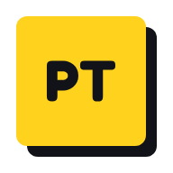
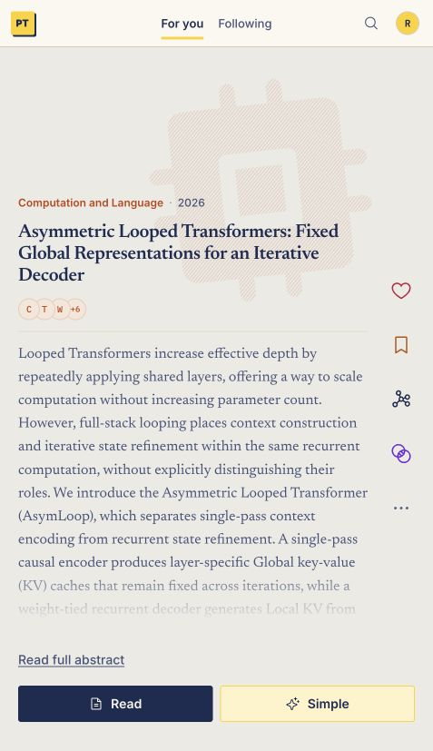
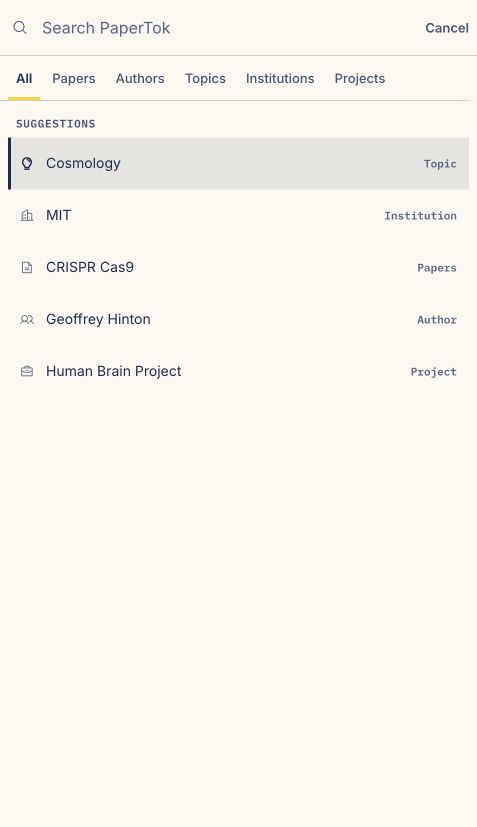
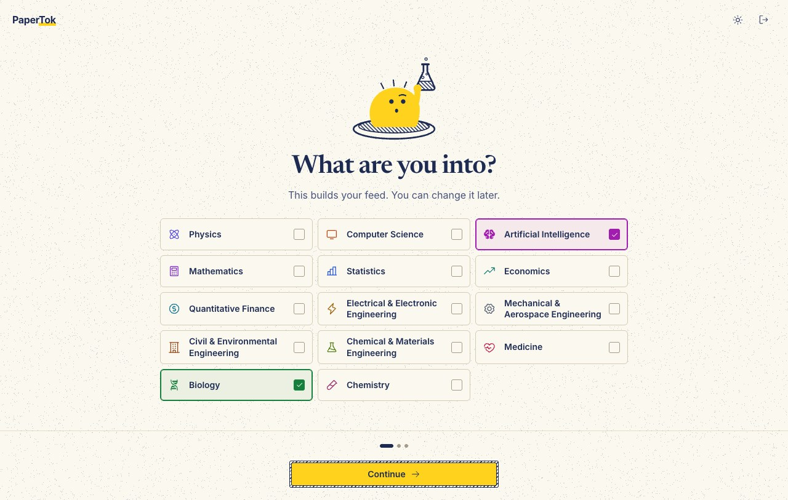
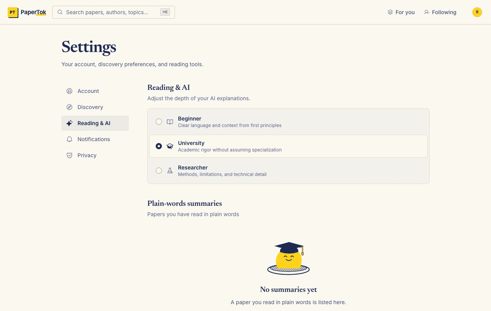
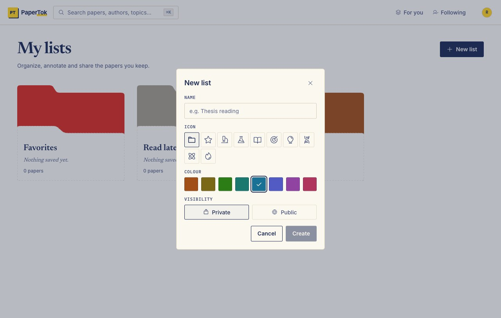
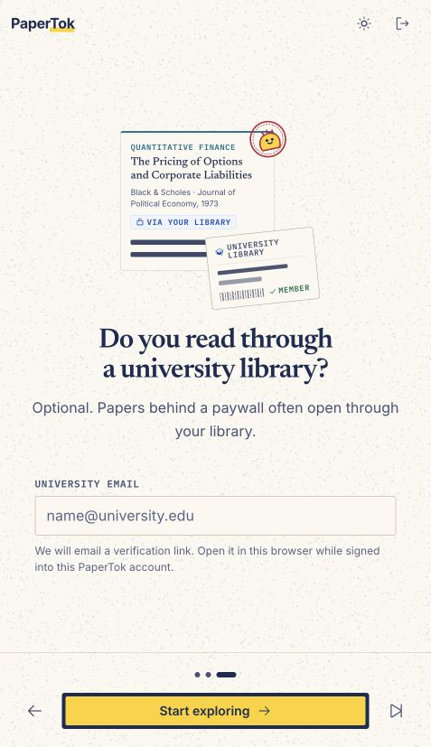
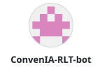
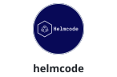

<div align="center">



# PaperTok

**Discover scientific papers. Read at your level. Keep what matters.**

[Open PaperTok](https://papertok.app/feed) · [Release notes](https://github.com/mugar123/papertok/releases/latest) · [Report a bug](https://github.com/mugar123/papertok/issues) · [Donate](https://github.com/sponsors/mugar123)

[](https://github.com/mugar123/papertok/releases/latest)
[](LICENSE)

<a href="docs/assets/release-0.3/feed.jpg"></a>&nbsp;&nbsp;<a href="docs/assets/release-0.3/search.jpg"></a>

<sub>The feed and search in PaperTok 0.3. Select any screenshot to view it at full size.</sub>

</div>

PaperTok is a scrollable, personalized feed of scientific papers. Start with a field you
care about, find work you would not have known to search for, and follow the authors and
topics you want to keep up with. Open the original paper, ask for a plain-words explanation
when supported full text is available, and collect useful papers in reading lists.

[Getting started](#getting-started) · [Product tour](#product-tour) · [Sources and access](#sources-and-access) · [Run locally](#run-locally) · [Donators](#donators)

> PaperTok is under active development. It is not affiliated with arXiv, OpenAlex, PubMed
> or any other data provider.

## Getting started

1. **Choose your interests.** Pick broad fields, then the topics within them. You can
   change them later in Settings → Discovery.
2. **Sign in and explore.** An account keeps your preferences, follows and saved papers
   together. Use **For you** for recommendations and **Following** for papers from the
   people and research areas you follow.
3. **Build your reading list.** Like a useful paper, save it for later, or open it to read.
   Use **Not interested** when you want fewer papers like one you see.

PaperTok works on desktop and phones, supports light and dark themes, and can be installed
from your browser for access from your home screen.

## Product tour

### Discover across fields

Choose among physics, computer science, AI, mathematics, economics, medicine, biology,
chemistry and engineering. **For you** combines your interests and follows with signals
from your reading and interactions; you can revise your choices as your work changes.
Scroll or swipe through papers, or use the up and down arrow keys on desktop.

<p align="center">
  <a href="docs/assets/readme-tour/choose-fields.jpg"></a>
</p>

*Start broad, then choose more specific topics. This example selects AI and biology.*

### Search, follow and explore connections

Open search with **/** or **⌘K / Ctrl+K**. Search for papers, authors, topics, institutions
or funded projects, then open a result to explore its publications. Follow the entities
you want to revisit in **Following**. You can also follow up to ten journals from their
journal pages; a journal name in the plain-words reader opens its page.

A paper can lead to your next one in two ways: **Similar papers** finds related work,
and the **citation map** shows references and citing papers when those records are
available. Re-center the map on another paper or download the linked papers as BibTeX.

### Read the original or choose an explanation level

**Read** opens the paper through the available original, PDF or library route.
**Read in plain words** uses AI to adapt supported full text to one of three levels:

| Level | What to expect |
| --- | --- |
| **Beginner** | Clear language and context from first principles. |
| **University** | Academic rigor without assuming specialization. |
| **Researcher** | Methods, limitations and technical detail. |

<p align="center">
  <a href="docs/assets/readme-tour/reading-levels.jpg"></a>
</p>

*Set your default level in Settings → Reading & AI. Previously read plain-words summaries appear below it.*

In the plain-words reader, select a passage to highlight it, add a note or ask for an
explanation. AI adaptations are labeled and do not replace the original article. If the
full text cannot be retrieved or a usage limit is reached, an explanation may be unavailable;
PaperTok does not present an abstract-only response as a rewrite of the full paper.

### Save, organize and share

Keep **Favorites**, **Read later** and your **Reading history** together in **My lists**.
Create named lists for a thesis, a course or a reading group, with an icon and colour to
help distinguish them. Lists can be private or published with a link you can share.

<p align="center">
  <a href="docs/assets/readme-tour/create-list.jpg"></a>
</p>

*Create a private collection for your own reading, or a public list to share.*

Export paper or list references as **BibTeX** or **RIS** for reference managers such as
Zotero, EndNote and Mendeley. To keep up between visits, opt in to the **weekly email
update** in Settings → Notifications. It is prepared on Mondays from the authors, topics,
institutions and projects you follow; journals are not included yet, and sending limits
can delay delivery.

### Use your university library

Verify a university email to let PaperTok check whether your library provides access to
an article. You can add this address even if you signed in with another Google or GitHub
account. When access is confirmed, **Read** uses the library route.

<p align="center">
  <a href="docs/assets/release-0.3/university.jpg"></a>
</p>

*University access is optional. This screenshot shows the PaperTok 0.3 verification screen.*

Verifying an email does not unlock every paywall. Availability depends on your institution,
the article and the subscription year; the publisher or library may require its own sign-in.

## Sources and access

PaperTok brings together records from **arXiv, OpenAlex, PubMed, OpenReview, Hugging Face**
and specialist sources. Coverage and available metadata vary by field and provider.

- **A paper record is not always full text.** You may be able to discover an article whose
  text is only available from its publisher or through a library.
- **Open access and peer review are different facts.** Preprints and working papers can be
  freely readable without having been peer reviewed. Check the paper's status and source.
- **Citation data can be incomplete.** A missing count or connection does not establish
  that a paper has never been cited.

For account data and analytics choices, see the [privacy policy](https://papertok.app/privacy.html).
For release history, see the [release notes](https://github.com/mugar123/papertok/releases).

<details>
<summary>About these screenshots</summary>

The mobile feed, search and university screenshots were captured for version 0.3 with a
disposable Firebase emulator account and live scholarly results. The desktop interest,
reading-level and list-creation screenshots were captured from the app on November 11,
2026 with a separate local emulator account. They show real interface states; no AI
explanation or university entitlement was generated for these new screenshots.

</details>

## Run locally

Requires **Node 22.18 or later**. The frontend uses React and Vite, the API runs on a
Cloudflare Worker, and Firebase provides authentication and saved user data.

```bash
git clone https://github.com/mugar123/papertok.git
cd papertok
npm ci
cp .env.example .env.local
npm run dev
```

The example configuration points the frontend at `http://localhost:8787`. In a second
terminal, start the Worker from the same repository:

```bash
npx wrangler dev --local --port 8787
```

Configure any required provider credentials in the ignored `.dev.vars` file using the
[Worker setup guide](worker/README.md#local-testing). Credentials do not belong in
frontend `VITE_*` variables. Firebase's public web configuration is already bundled in
`src/services/firebase.ts`.

For signed-in development, use local disposable accounts:

```bash
npm run dev:emulators
```

This replaces `npm run dev` and requires **firebase-tools and Java 21 or later**. It starts
local Auth and Firestore emulators and signs in a test account. Worker routes that require
production identity reject emulator tokens, so those flows cannot be verified end to end
with this account. See [local testing](worker/README.md#local-testing) for account switching
and limits.

Before opening a pull request, run:

```bash
npm run check
```

This checks secrets, lint, unused code, types and tests, then builds the frontend and
packages the Worker without deploying it. The frontend deploys through Vercel; the Worker
has a separate deployment. See [the architecture map](ARCHITECTURE.md) for system boundaries.

## Contributing

Bug reports, ideas and pull requests are welcome. For large changes, open an issue first.
Start with [the architecture map](ARCHITECTURE.md) for runtime diagrams and documentation
owners. See [CONTRIBUTING.md](CONTRIBUTING.md) and [SECURITY.md](SECURITY.md).

## Donators

PaperTok is an independent open-source project. These people support it with their own
money. Thank you.

<!-- Generated by scripts/build-donor-cards.mjs: add the handle to docs/assets/donors/donors.json and rerun it. -->
<!-- donors:start -->
<p align="center">
  <a href="https://github.com/ConvenIA-RLT-bot" title="ConvenIA-RLT-bot"><picture><source media="(prefers-color-scheme: dark)" srcset="docs/assets/donors/convenia-rlt-bot-dark.svg"></picture></a>
  <a href="https://github.com/XMihura" title="XMihura"><picture><source media="(prefers-color-scheme: dark)" srcset="docs/assets/donors/xmihura-dark.svg"></picture></a>
  <a href="https://github.com/felipebasurto" title="felipebasurto"><picture><source media="(prefers-color-scheme: dark)" srcset="docs/assets/donors/felipebasurto-dark.svg"></picture></a>
  <a href="https://github.com/helmcode" title="helmcode"><picture><source media="(prefers-color-scheme: dark)" srcset="docs/assets/donors/helmcode-dark.svg"></picture></a>
  <a href="https://github.com/sponsors/mugar123" title="Donate to PaperTok on GitHub Sponsors"><picture><source media="(prefers-color-scheme: dark)" srcset="docs/assets/donors/donate-dark.svg"></picture></a>
</p>
<!-- donors:end -->

## Acknowledgements

PaperTok depends on open scholarly infrastructure, especially arXiv, OpenAlex and PubMed.

## License

[MIT](LICENSE). Built by [Nicolás Muñoz](https://github.com/mugar123),
[Samuel](https://x.com/disamdev), Pablo Presa and Asier.
