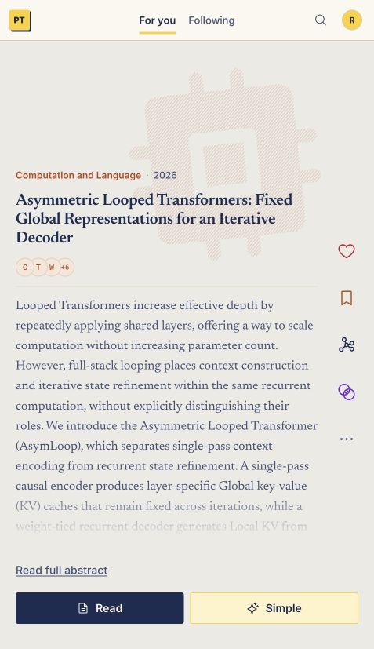
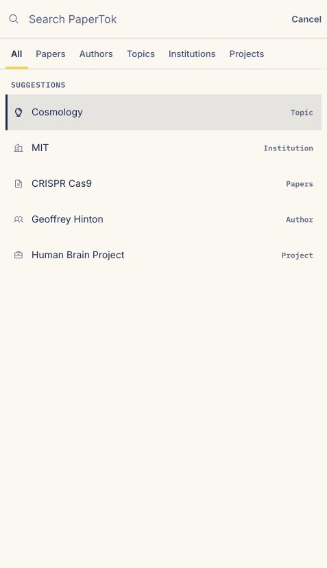
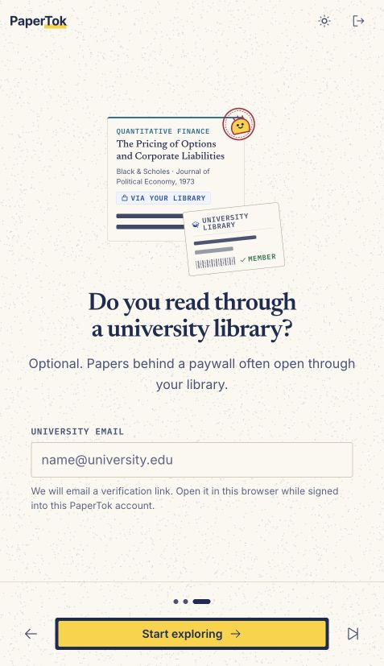
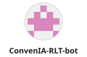

<div align="center">


# PaperTok

**A scrollable, personalized feed of scientific papers.**

[Open PaperTok](https://papertok.app/feed) · [Release notes](https://github.com/mugar123/papertok/releases/latest) · [Report a bug](https://github.com/mugar123/papertok/issues) · [Donate](https://github.com/sponsors/mugar123)

[](https://github.com/mugar123/papertok/releases/latest)
[](LICENSE)

&nbsp;&nbsp;&nbsp;&nbsp;

<sub>Screenshots of PaperTok 0.3, captured locally with a disposable Firebase emulator account. Paper results come from live scholarly sources.</sub>

</div>

PaperTok helps you find research when you don't know what to search for. Pick your fields,
scroll, and the feed learns from what you read, like, save, skip and follow.

> [!NOTE]
> PaperTok is under active development. It is not affiliated with arXiv, OpenAlex, PubMed
> or any other data provider.

## What's new in 0.3

University library access, recommendations that adapt to your reading pace, a redesigned
search palette, PDF export and a citation map built for phones. Read the
[0.3 release notes](https://github.com/mugar123/papertok/releases/tag/v0.3.0).

## Features

### Discover

- **Personalized feed** from arXiv, OpenAlex, PubMed, OpenReview, Hugging Face and
  specialist sources. Likes, saves, skips and reading time shape your recommendations.
- **Touch and keyboard**: swipe or use the arrow keys, pull to refresh on phones, undo
  Not interested, and hold Save to choose a list.
- **Search** papers, authors, topics, institutions and funded projects with `/`, with a
  tab for each result type.
- **Similar papers** from the card's action rail, next to likes, saves and connections.
- **Follow** authors, topics, institutions and projects. Explorer pages list publications,
  facts from the source and verified ORCID links when available.

### Read

- **Read in plain words** at Beginner, University or Researcher level when supported full
  text is available. Highlight passages, write notes and ask for explanations.
- **University library access**: verify a university email, including a secondary address
  on a Google or GitHub account. When your library confirms access to an article, Read
  opens it through that route. Coverage depends on your institution, the article and the
  subscription year.
- **Citation map**: explore references and citing papers on desktop or phone, re-center on
  another paper, and download references as BibTeX.
- **PDF and LaTeX export** of the rewrite with your selected highlights and notes, the
  paper's attribution and an AI disclosure.

### Keep

- **Reading lists** with colors and public links you can share.
- **The PaperTok Weekly**: an opt-in Monday email with new papers from what you follow.
- **Installable** on your home screen, with light and dark themes.

## Run locally

Requires Node 22.18 or later.

```bash
git clone https://github.com/mugar123/papertok.git
cd papertok
npm ci
cp .env.example .env.local
npm run dev
```

The example points the frontend at a local Cloudflare Worker. Start it with
`npx wrangler dev --local --port 8787`; provider credentials belong in the ignored
`.dev.vars` file, as described in [`worker/README.md`](worker/README.md#local-testing).
Firebase web configuration is already bundled in `src/services/firebase.ts`.

For signed-in development, use `npm run dev:emulators` with firebase-tools and Java 21
or later. It starts local Auth and Firestore emulators and signs in a disposable account;
Worker routes that require production identity reject its tokens. See the
[local testing guide](worker/README.md#local-testing) for account switching and limits.

Run `npm run check` before opening a pull request.

<details>
<summary><strong>Analytics and error monitoring</strong></summary>

Reader analytics distinguish `reader_open` (the internal reader becomes visible),
`paper_open` (an attempt to open the original/PDF), and `paper_rewrite` (an attempted
Worker request). `paper_rewrite_result` reports success, incomplete output,
failure or cancellation, with the reading level, cache status, bounded duration
and an allowlisted error code. Cached results do not count as Worker requests.
`auth_prompt_view` records the sign-in dialog's reason; `auth_result` distinguishes
successful, cancelled and failed Google/GitHub attempts without account details.

Sentry receives frontend and Worker errors in separate `papertok-web` and
`papertok-worker` projects. Frontend collection covers the React error boundary,
uncaught JavaScript errors and unhandled promise rejections, on production hosts
and behind the analytics opt-out. Worker collection covers uncaught request,
scheduled-task and Durable Object failures, caught router and rewrite failures,
and otherwise unreported 5xx responses. Expected 4xx responses are excluded.
Backend operational reporting is independent of browser analytics consent.

Reports keep standard error types, code locations, release identifiers and
allowlisted operation/status tags. Messages, request data, account details,
paper content and breadcrumbs are removed; transport IP inference is suppressed.
Tracing, replay, logs and metrics are disabled. `app_error` remains a product
counter in PostHog. Hidden frontend source maps upload during Vite builds and
are deleted from the published assets. Set `SENTRY_AUTH_TOKEN` in the Vercel
Production build environment; never use a `VITE_*` variable for this credential.
The Worker deployment command uploads its maps separately (see `worker/README.md`).

</details>

## Contributing

Bug reports, ideas and pull requests are welcome. For large changes, open an issue first.
See [CONTRIBUTING.md](CONTRIBUTING.md) and [SECURITY.md](SECURITY.md).

## Donators

PaperTok is an independent open-source project. These people support it with their own
money. Thank you.

<!-- Generated by scripts/build-donor-cards.mjs: add the handle to docs/assets/donors/donors.json and rerun it. -->
<!-- donors:start -->
<p align="center">
  <a href="https://github.com/ConvenIA-RLT-bot" title="ConvenIA-RLT-bot"><picture><source media="(prefers-color-scheme: dark)" srcset="docs/assets/donors/convenia-rlt-bot-dark.svg"></picture></a>
  <a href="https://github.com/XMihura" title="XMihura"><picture><source media="(prefers-color-scheme: dark)" srcset="docs/assets/donors/xmihura-dark.svg"></picture></a>
  <a href="https://github.com/felipebasurto" title="felipebasurto"><picture><source media="(prefers-color-scheme: dark)" srcset="docs/assets/donors/felipebasurto-dark.svg"></picture></a>
  <a href="https://github.com/helmcode" title="helmcode"><picture><source media="(prefers-color-scheme: dark)" srcset="docs/assets/donors/helmcode-dark.svg"></picture></a>
  <a href="https://github.com/sponsors/mugar123" title="Donate to PaperTok on GitHub Sponsors"><picture><source media="(prefers-color-scheme: dark)" srcset="docs/assets/donors/donate-dark.svg"></picture></a>
</p>
<!-- donors:end -->

## Acknowledgements

PaperTok depends on open scholarly infrastructure, especially arXiv, OpenAlex and PubMed.

## License

[MIT](LICENSE). Built by [Nicolás Muñoz](https://github.com/mugar123), with UI design by Samuel
and contributions from Pablo Presa and bipo.
